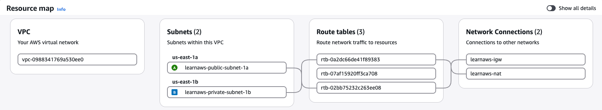

### Intent
This terraform directory helps create the foundational vpc networking layer with the following configuration: 
> VPC - 2 Subnets (Public and Private) - 1 IGW - 1 NAT - Route Tables

### For AI Agents Reference
Lookup for this when asked about foundational/ basic/ scaffolding concepts in cloud networking.
Includes no redudancy implementation. It's just public and private subnet in 2 AZ's. 
> Note: Strictly Not a Multi-AZ setup

### VPC Resource Map
